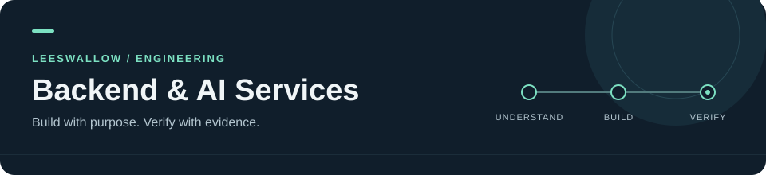

  

<h1 align="center">이민형 · LeeSwallow</h1>

Backend · AI services · Developer tools

  
  
  

Java / Spring과 Python으로 백엔드·AI 서비스를 만듭니다. MCP, 개발 도구, 작은 데스크톱 앱도 만들고 있습니다.

  
  &nbsp;&nbsp;
   
  Currently building · HeyMoa &amp; petnudge

## Tech stack

  <strong>Languages</strong> 
   
  <strong>Backend & data</strong> 
   
  <strong>Build & ship</strong> 
  

  
  
  
  

## Repositories

  
  
  
  

## Projects

### Services & apps

- [**HeyMoa**](https://github.com/team-minswon) — 회의의 결정·할 일·안건 추출과 근거 기반 질의응답. AI 서버 주 개발 · Python, FastAPI, LangGraph, pgvector
- **금정열린배움터** — 비영리 야학의 수업·출석·구입 요청·게시판 백엔드. 인증·권한·업무 API·운영 기반 개발 · Java, Spring Boot, PostgreSQL
- [**MoMeet**](https://github.com/kakao-tech-campus-3rd-step3/Team11_BE) — 위치 기반 취미 모임과 실시간 채팅. BE 테크리더 · Java, Spring Boot, WebSocket/STOMP, PostGIS
- [**petnudge**](https://github.com/LeeSwallow/petnudge) — 할 일·포모도로·코딩 에이전트를 연결하는 데스크톱 펫. 개인 프로젝트 · TypeScript, Electron, SQLite, 로컬 MCP
- [**Detective Agent**](https://github.com/LeeSwallow/asm-team08-ai-study) — 자연어 심문과 증거 교차검증을 결합한 추리 게임. BE·AI 엔진 주 개발 · FastAPI, LangGraph, Neo4j
- [**Detox-Agent**](https://github.com/GoInWater301/Detox-Agent) — 사용자별 DNS 사용량 집계·차단과 AI 사용 습관 리뷰. WebServer·gRPC 인터페이스·AI 리뷰 연동 · Spring WebFlux, R2DBC, Redis

### Term projects & prototypes

- **온디바이스 낙상 감지 시스템 · 졸업 과제** — 인체 골격의 움직임을 분석하는 낙상 감지. Conv1D-GRU 모델 개발·후보 선정, 후처리 설계, 보드 실행 구조·메모리 배치 검토 · Python, C, MoveNet, STM32N6570-DK
- [**SmartHome-MCP**](https://github.com/LeeSwallow/PNU-TERM_SmartHome-MCP) — MQTT 기기 등록·센서 조회·액추에이터 제어와 MCP 자연어 제어 · Python, FastAPI, MQTT, Arduino
- [**Emotion Diary**](https://github.com/LeeSwallow/PNU-TERM_Emotion-Diary-App) — Android 감정 일기 앱과 MCP 백엔드 · Kotlin, Android, Python, FastMCP, Supabase
- [**PDF Summarizer**](https://github.com/LeeSwallow/PNU-BOOTCAMP_PDF-Summarizer) — PDF 업로드·뷰어·페이지 영역 선택·요약 생성 · Python, FastAPI, 웹 클라이언트
- [**Pomodoro Todo**](https://github.com/LeeSwallow/PNU-TERM_Pomodoro-Todo-Webapp) — 포모도로와 할 일을 함께 관리하는 웹 앱 · TypeScript, SvelteKit, Drizzle, SQLite
- [**공공데이터 분석**](https://github.com/LeeSwallow/PNU-TERM_elderly-people-Research) — 부산 인구·고령화와 사고 데이터 탐색·지도 시각화 · Python, pandas, GeoPandas, Folium
- [**FPGA 두더지 게임**](https://github.com/LeeSwallow/PNU-TERM-logic_circuit-mole_game) — 상태 머신 기반 게임 진행·점수·생명·스테이지와 키패드·LED·부저 제어 · Verilog HDL, FPGA

### Research & developer tooling

- **HeyMoa 개발 하네스** — 팀 공통 개발 도구·문서 절차, 제품 결정부터 이슈 마감까지의 흐름과 단계별 시간·토큰 계측
- **HeyMoa 온톨로지 실험** — 회의 정보를 명제·관계·안건으로 표현하는 구조와 검색 방법 실험, 데이터셋·평가 기준·결과 관리
- **LLM Wiki 도구** — 자료 수집·위키 정리·질의·링크 검사를 연결하는 개인 지식 관리 도구, 수집·구조 검증 스크립트와 플러그인 구성

비공개 작업은 주제와 담당 범위만 소개합니다. 상세 역할과 검증 기록은 [프로젝트 기록](./docs/project-details.md)에 정리했습니다.

## GitHub

  
  

공개 저장소 기준 통계입니다. 언어 비율은 숙련도나 비공개 프로젝트 기여를 나타내지 않습니다.

  <a href="mailto:lmh2157@outlook.kr">Say hello ↗</a> ·
  <a href="https://github.com/LeeSwallow?tab=repositories">All repositories ↗</a>

